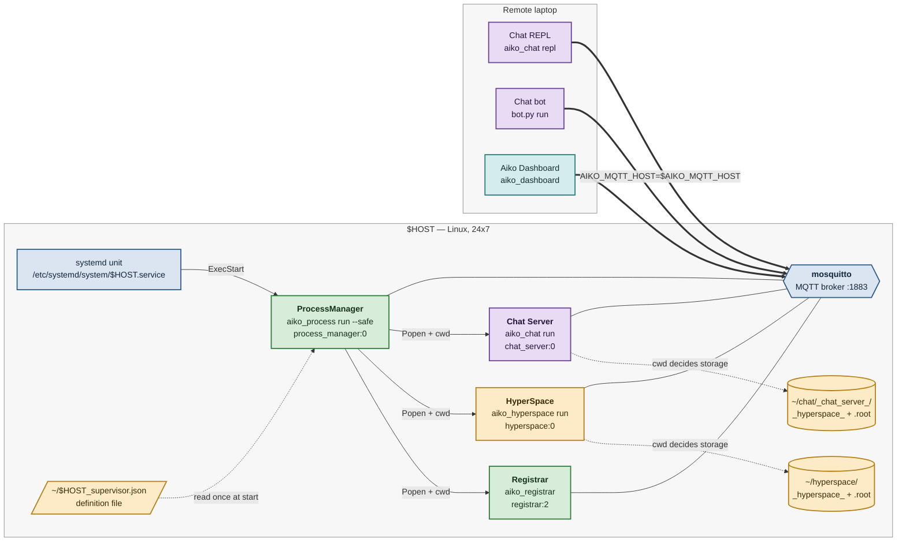

# Tutorial — an Aiko Services 24x7 production instance on Linux
How to turn a recent Ubuntu host into an Aiko Services instance that starts at
boot, restarts on failure, and needs nothing started by hand.

The whole arrangement is **one** operating system daemon. `systemd` starts a
single ProcessManager, and the ProcessManager definition file starts everything
else. There is no unit per Service, and there should never be one.

## Goals

1. **`systemd` starts one ProcessManager** on `$HOST`, at boot, under an
   unprivileged account, restarting on failure.
2. **The ProcessManager owns three Services**, from a JSON definition file:
   - the **Registrar** — Service discovery for the namespace
   - **HyperSpace** — the Service graph, backed by file-system storage
   - the **Aiko Chat Server** — the application backend.
3. **HyperSpace storage is initialized** from the `examples/hyperspace` tree
   that ships in the Aiko Services repository, outside the source tree.
4. **A remote laptop drives the instance** over MQTT at `$AIKO_MQTT_HOST`:
   an Aiko Chat REPL session, an Aiko Chat `bot.py`, and the Aiko Dashboard.
   That laptop already has Aiko Services and Aiko Chat installed.
5. **The posture is explicit.** The ProcessManager runs `--safe`, so the
   message bus cannot ask it to create or destroy processes.

The host may be physical (x86-64 or ARM laptop, Raspberry Pi) or virtual
(Intel or ARM server). Nothing below is specific to either.

## Overview



| Color | Meaning |
|---|---|
| Blue | Operating system and broker — not Aiko Services |
| Green | Aiko Services framework core: ProcessManager, Registrar |
| Amber | Storage: HyperSpace Services, their file-system trees, the definition file |
| Purple | Application: Aiko Chat Server, REPL, bot |
| Teal | Development and operations tool: the Aiko Dashboard |

Two relationships in that diagram carry the whole design:

- **The definition file is read once, at start.** Changing it has no effect
  until the ProcessManager restarts.
- **`cwd` decides storage.** HyperSpace file Storage resolves `_hyperspace_`
  and `.root` against the working directory, and its `storage_url` argument is
  accepted but not implemented. The working directory is the only selector
  there is — which is why the definition file's object form exists.

## Prerequisites

On `$HOST`:

| Item | Requirement |
|---|---|
| Operating system | A recent Ubuntu, with `systemd` (any supported release) |
| Python | `>= 3.12` and `< 3.15`, as `python3`, with `python3-venv` |
| Broker | `mosquitto` installed from the distribution and started by `systemd` — the out-of-the-box `apt-get install mosquitto mosquitto-clients` arrangement, which listens on `127.0.0.1:1883` and allows anonymous clients |
| Account | An unprivileged account, `$USERNAME`, with `sudo` for the install step only |
| Tools | `git` |
| Hostname | `$HOST`, which names both the ProcessManager and its `systemd` unit |

On the remote laptop: Aiko Services and Aiko Chat already installed in a
virtual environment, and IP reachability to `$AIKO_MQTT_HOST` on port 1883.

Confirm the prerequisites rather than assuming them:

```bash
python3 --version
systemctl is-enabled mosquitto && systemctl is-active mosquitto
mosquitto_sub -h localhost -t '$SYS/broker/version' -C 1 -W 3
```

### Conventions

Every path in this tutorial follows these, and nothing else is assumed:

| What | Where |
|---|---|
| Python virtual environment | `~$USERNAME/venvs/venv_$PYTHON_VERSION/` |
| Aiko Services source | `~$USERNAME/projects/aiko_services/` |
| Aiko Chat source | `~$USERNAME/projects/aiko_chat/` |
| HyperSpace storage | `~$USERNAME/hyperspace/` |
| Chat Server storage | `~$USERNAME/chat/_chat_server_/` |
| ProcessManager definition | `~$USERNAME/${HOST}_supervisor.json` |
| `systemd` unit | `/etc/systemd/system/${HOST}.service` |

The storage trees live **outside** the source tree deliberately. `.root` is
not in the repository's `.gitignore`, so initializing inside
`src/aiko_services/examples/hyperspace/` leaves the checkout permanently
dirty and fights every `git pull`.

---

## 1 · Shell variables

Set these in every terminal on `$HOST` that runs a command below.

```bash
HOST=$(hostname -s)                 # names the ProcessManager AND the unit
USERNAME=$(id -un)
PYTHON_VERSION=$(python3 -c 'import sys; print("%d.%d" % sys.version_info[:2])')
VENV=/home/$USERNAME/venvs/venv_$PYTHON_VERSION
PROJECTS=/home/$USERNAME/projects
echo "HOST=$HOST USERNAME=$USERNAME VENV=$VENV"
```

`$HOST` is one value used twice: the `systemd` unit becomes
`${HOST}.service`, and the ProcessManager's Service name becomes `$HOST`. The
renderer derives the unit name from `--name`, so they cannot drift — and
`aiko_process list -n $HOST` and `systemctl status $HOST` therefore name the
same thing.

## 2 · Virtual environment and source

The Aiko Services `examples/` directory is **excluded from the wheel**, and
the HyperSpace example lives there. So this needs a clone with an editable
install, not `pip install aiko_services`.

```bash
mkdir -p /home/$USERNAME/venvs $PROJECTS
python3 -m venv $VENV
$VENV/bin/pip install --upgrade pip

git clone https://github.com/geekscape/aiko_services.git $PROJECTS/aiko_services
git clone https://github.com/geekscape/aiko_chat.git     $PROJECTS/aiko_chat

$VENV/bin/pip install -e $PROJECTS/aiko_services
$VENV/bin/pip install -e $PROJECTS/aiko_chat
```

On a Raspberry Pi add `--system-site-packages` to the `venv` command:
`python3-libcamera` is an operating system package and is not on PyPI, so an
isolated environment cannot drive the camera at all.

Confirm the console scripts, and which code they import:

```bash
ls $VENV/bin | grep -E '^aiko_'
$VENV/bin/python3 -c 'import aiko_services, aiko_chat
print(aiko_services.__file__); print(aiko_chat.__file__)'
```

Expect `aiko_chat`, `aiko_dashboard`, `aiko_hyperspace`, `aiko_process`,
`aiko_recorder`, `aiko_registrar`, `aiko_storage_file`, `aiko_supervisor`,
and both paths under `$PROJECTS`. That second command is the one worth
keeping: it is the only way to know which code actually runs.

## 3 · Smoke test, in a namespace of its own

Before anything is installed, prove the broker and the framework work
together. Use a separate namespace, so this cannot touch a Service anything
else depends on:

```bash
export AIKO_MQTT_HOST=localhost
export AIKO_NAMESPACE=aikotest

$VENV/bin/aiko_registrar &                  # note the pid it prints
REGISTRAR_PID=$!
$VENV/bin/aiko_dashboard                    # 'x' or 'q' to leave
kill $REGISTRAR_PID                         # the exact pid, never a pattern
unset AIKO_NAMESPACE
```

Kill by the pid you recorded. A pattern such as `pkill -f aiko_registrar` is
wide enough to match a long-lived Registrar that belongs to someone else. A
Registrar holds its Service history only in memory.

## 4 · Initialize HyperSpace storage

Copy the example out of the source tree, then initialize it. `cp -a`
preserves the relative symbolic links the example is made of:

```bash
cp -a $PROJECTS/aiko_services/src/aiko_services/examples/hyperspace \
      /home/$USERNAME/hyperspace
cd /home/$USERNAME/hyperspace
$VENV/bin/aiko_storage_file initialize
ls -la                                      # .root -> this directory
$VENV/bin/aiko_storage_file list -b -r      # the Categories that came with it
```

Expect `devices/`, `federation/`, `hosts/`, `locations/` (with `home` and
`office`) and `services/`, each `category:0`.

`initialize` creates `.root`, an **absolute** symbolic link to the directory
you ran it in, beside the pre-existing `_hyperspace_/` content hierarchy. So
moving or renaming this directory later breaks it. Run `initialize` again if
you do.

> The command is `aiko_storage_file initialize`.
> `src/aiko_services/examples/hyperspace/ReadMe.md` says
> `aiko_hyperspace initialize`, and `hyperspace.py` advises
> `aiko_storage initialize` — neither exists. The `aiko_hyperspace` group
> offers `add create destroy dump exit list remove run update` only.

## 5 · Initialize the Chat Server storage

The Chat Server embeds a HyperSpace of its own, and `aiko_chat run` reads
`share["entries"]["channels"]` during start-up — a bare `KeyError` if that
Category is absent. So its storage and channels must exist **before** the
ProcessManager ever starts it. This is a set-up step, not a start-up step:

```bash
mkdir -p /home/$USERNAME/chat
cd /home/$USERNAME/chat
export AIKO_MQTT_HOST=localhost
PATH=$VENV/bin:$PATH $PROJECTS/aiko_chat/src/aiko_chat/chat_start.sh
```

`chat_start.sh` creates `_chat_server_/` **relative to its caller's working
directory**. It initializes storage inside it, creates the `channels` and
`users` Categories, and lists them. Then it runs the server in the
foreground. Once the listing appears, stop it from a second terminal and
leave the storage behind:

```bash
PATH=$VENV/bin:$PATH AIKO_MQTT_HOST=localhost aiko_chat exit
```

Confirm what was created:

```bash
cd /home/$USERNAME/chat/_chat_server_
$VENV/bin/aiko_storage_file list --bootstrap --long_format --recursive
```

Expect `channels/` with `general`, `random`, `llm`, `robot`, `yolo`, and
`users/`.

**Do not put `chat_start.sh` in the definition file.** Its last line is
`aiko_chat run`, not `exec aiko_chat run`, so the pid the ProcessManager holds
is the shell's. `aiko_process destroy` signals the direct child only, and
would leave the Chat Server orphaned.

## 6 · The definition file

```bash
cat > /home/$USERNAME/${HOST}_supervisor.json <<EOF
[
  "true  aiko_registrar",

  {"enabled": true,
   "command": "aiko_hyperspace run",
   "cwd":     "/home/$USERNAME/hyperspace"},

  {"enabled": true,
   "command": "aiko_chat run",
   "cwd":     "/home/$USERNAME/chat/_chat_server_"},

  {"enabled": false,
   "command": ["aiko_chat", "run", "--llm"],
   "cwd":     "/home/$USERNAME/chat/_chat_server_"},

  "false aiko_recorder"
]
EOF
$VENV/bin/python3 -c "import json,sys; d=json.load(open(sys.argv[1]));
print(len(d),'entries')" /home/$USERNAME/${HOST}_supervisor.json
```

An entry is either a **string** or an **object**. Both forms must have the
`enabled` flag:

| Form | Grammar | Use it when |
|---|---|---|
| String | `"enabled command [arguments ...]"`, split on whitespace | No options are needed — the Registrar |
| Object | `{"enabled": …, "command": …, "cwd": …}`, split with `shlex`; `command` may be a list | A working directory is needed, or an argument contains a space |

Entry by entry:

1. **`"true  aiko_registrar"`** — first, because the others discover through
   it. The order is advisory, not a dependency: entries start in file order
   with no readiness wait, and Services retry discovery.
2. **HyperSpace** — `aiko_hyperspace run` with no `STORAGE_URL` means the
   working directory, so `cwd` is what selects the storage from step 4. No
   wrapper script, and no extra process in the tree.
3. **The Chat Server** — note the path ends in `_chat_server_`, which is where
   step 5 put the storage.
4. **The `--llm` variant, disabled** — the command as a **list**, which needs
   no quoting rules at all. Enable this *or* entry 3, never both. It needs
   `ollama` reachable.
5. **`"false aiko_recorder"`** — the flag doing its original job: present in
   the definition, not running.

JSON has no comments, which is why the notes are here. Two traps:

- **An unknown key is reported and the entry skipped** — `"cmd"` for
  `"command"` is the mistake worth a diagnostic, and it gets one.
- **The string form cannot hold an argument with a space.** It splits on
  whitespace, so `"true /bin/sh -c \"sleep 5; echo done\""` becomes seven
  tokens and the quotes survive as literal characters. Use the object form.

## 7 · Dry run, by hand

Run the definition under a throwaway name before installing anything. This is
where a bad path or a missing Category appears, with the log in front of you
rather than in the journal:

```bash
cd /home/$USERNAME
PATH=$VENV/bin:$PATH PYTHONUNBUFFERED=1 AIKO_MQTT_HOST=localhost \
  $VENV/bin/aiko_process run --name dryrun --unsafe \
  /home/$USERNAME/${HOST}_supervisor.json
```

Expect three `Create: <NNNNNN>` lines, one `Disabled:` line for each `false`
entry, and no `FileNotFoundError` or `not a directory`. From a second
terminal:

```bash
PATH=$VENV/bin:$PATH AIKO_MQTT_HOST=localhost aiko_process list -n dryrun
PATH=$VENV/bin:$PATH AIKO_MQTT_HOST=localhost aiko_process exit -n dryrun -gt 0
```

`--unsafe` is here only so that `exit` works over the bus. The option
`--name dryrun` keeps this out of the way of the service you are about to
install. The installed unit uses neither.

## 8 · Render the unit

`render` writes nothing. Read it before installing it:

```bash
$VENV/bin/aiko_supervisor render --name $HOST --user $USERNAME \
  --working_directory /home/$USERNAME \
  --executable $VENV/bin/aiko_process \
  --mqtt_host localhost \
  --after network-online.target --after mosquitto.service \
  --wants network-online.target \
  --environment PATH=$VENV/bin:/usr/local/bin:/usr/bin:/bin \
  /home/$USERNAME/${HOST}_supervisor.json
```

### `/etc/systemd/system/$HOST.service`

With `HOST=aiko`, `USERNAME=ubuntu` and `PYTHON_VERSION=3.12`, that renders
exactly:

```ini
# /etc/systemd/system/aiko.service
# Aiko Services ProcessManager
#
# Rendered by aiko_supervisor.  Change the DaemonDefinition and render
# again, rather than this file

[Unit]
Description=Aiko Services ProcessManager
After=network-online.target mosquitto.service
Wants=network-online.target

[Service]
Type=simple
User=ubuntu
WorkingDirectory=/home/ubuntu
Environment=PYTHONUNBUFFERED=1
Environment=PATH=/home/ubuntu/venvs/venv_3.12/bin:/usr/local/bin:/usr/bin:/bin
Environment=AIKO_MQTT_HOST=localhost
ExecStart=/home/ubuntu/venvs/venv_3.12/bin/aiko_process run --name aiko /home/ubuntu/aiko_supervisor.json
KillSignal=SIGTERM
TimeoutStopSec=30
Restart=always
RestartSec=5

[Install]
WantedBy=multi-user.target
```

Four of those lines are load-bearing, and three of them look optional:

| Line | Why it is there |
|---|---|
| `Environment=PATH=…` | **`systemd`'s own `PATH` omits the virtual environment.** A bare `aiko_registrar` entry then fails with `FileNotFoundError`, which the ProcessManager logs as a *warning* only — so the Service is simply absent and nothing says why. `aiko_chat` needs this most, being both a console script and an importable package. |
| `Environment=PYTHONUNBUFFERED=1` | Python block-buffers stdout when it is a pipe, which is what a service gets. Without it the log never reaches the journal and the service looks silent. |
| `After=…mosquitto.service` | Otherwise the ProcessManager races the broker at boot. |
| `TimeoutStopSec=30` | Longer than the ProcessManager's own grace time (5 s + 25 s margin), so `systemd` cannot kill the ProcessManager while its children are still stopping. The `DaemonDefinition` refuses a timeout that is not. |

`Restart=always` is here because the ProcessManager's `--watchdog` option is
recorded but relaunches nothing yet. The operating system does the
restarting.

Note what is **not** there: no `--unsafe`, so the ProcessManager comes up
safe. `KillMode` is unset, so `systemd` defaults to `control-group` and
`systemctl stop` signals every child — which is what you want.

## 9 · Install, enable, start

`install` is the only command that changes the host, and it writes to
`/etc/systemd/system/`, so it needs root. It writes the unit, runs
`daemon-reload` and enables the unit:

```bash
sudo $VENV/bin/aiko_supervisor install --name $HOST --user $USERNAME \
  --working_directory /home/$USERNAME \
  --executable $VENV/bin/aiko_process \
  --mqtt_host localhost \
  --after network-online.target --after mosquitto.service \
  --wants network-online.target \
  --environment PATH=$VENV/bin:/usr/local/bin:/usr/bin:/bin \
  /home/$USERNAME/${HOST}_supervisor.json

sudo systemctl start $HOST
systemctl status $HOST --no-pager
```

`aiko_supervisor start | stop | status | uninstall --name $HOST` wrap the same
`systemctl` calls, if you prefer one command vocabulary.

Make the journal survive a reboot, so a boot-time failure is still readable
afterwards:

```bash
sudo mkdir -p /etc/systemd/journald.conf.d
printf '[Journal]\nStorage=persistent\n' |
  sudo tee /etc/systemd/journald.conf.d/99-persistent.conf
sudo systemctl restart systemd-journald
journalctl --header | grep -m1 'File path'      # expect /var/log/journal/...
```

## 10 · Verify, four independent ways

```bash
journalctl -u $HOST -n 60 --no-pager
```

Expect `Create: <000001> ['aiko_registrar']`, two more `Create:` lines for
HyperSpace and the Chat Server, and `Disabled:` for each `false` entry.

```bash
pgrep -af 'bin/aiko_registrar|aiko_hyperspace|aiko_chat'
PATH=$VENV/bin:$PATH AIKO_MQTT_HOST=localhost aiko_process list -n $HOST
PATH=$VENV/bin:$PATH AIKO_MQTT_HOST=localhost aiko_registrar list
mosquitto_sub -h localhost -t "aiko/#" -v -C 10
```

`aiko_process list` is the one that proves the message bus, rather than a
retained topic: the request goes out over MQTT and the reply comes back, so a
reply means discovery and dispatch both work. `list` is also one of only two
functions a `--safe` ProcessManager accepts.

Then the Dashboard, which has a page for each of these:

```bash
PATH=$VENV/bin:$PATH AIKO_MQTT_HOST=localhost aiko_dashboard
```

Select a Service and press `[Enter]` (or `S`) for its page. The default
registry ships pages for `category`, `hyperspace`, `process_manager`,
`recorder` and `registrar`. The ProcessManager page title should read
**`posture: safe`**, and the HyperSpace page should show the Categories from
step 4.

Finally, prove it survives a restart — the only test that matters for 24x7:

```bash
systemctl is-enabled $HOST
sudo reboot
# once it is back
uptime -s; systemctl is-active $HOST; pgrep -af bin/aiko_registrar
```

## 11 · Open the broker to the remote laptop

Two changes, and the second is not optional once the first is made. Replace
every placeholder below with your own values.

```bash
sudo tee /etc/mosquitto/conf.d/aiko.conf >/dev/null <<'EOF'
listener 1883
allow_anonymous false
password_file /etc/mosquitto/passwd
EOF

# Interactive; it prompts for the password and never echoes it
sudo mosquitto_passwd -c /etc/mosquitto/passwd aiko_user
sudo chown mosquitto:mosquitto /etc/mosquitto/passwd
sudo chmod 600 /etc/mosquitto/passwd
sudo systemctl restart mosquitto
```

> **`allow_anonymous true` on a non-localhost listener means anyone who can
> reach port 1883 can publish to any Actor's `/in` topic.** `--safe` limits
> what the ProcessManager will act on. It does nothing for the other
> Services, and the `control` topic stays an unguarded write path into
> every Actor's shared state. Treat broker exposure as the real security
> boundary: authenticate it, firewall it to known addresses, and use TLS if
> it crosses a network you do not own.

### Telling the Services the credentials

Aiko Services reads all of this from the environment:

| Variable | Meaning |
|---|---|
| `AIKO_MQTT_HOST` | Broker host |
| `AIKO_MQTT_PORT` | Broker port; whatever your listener uses |
| `AIKO_USERNAME` | Broker user. **Setting it enables TLS by default** |
| `AIKO_PASSWORD` | Broker password |
| `AIKO_MQTT_TLS` | `true` or `false`, overriding that default |
| `AIKO_MQTT_TRANSPORT` | `tcp` or `websockets` |
| `AIKO_NAMESPACE` | Topic namespace, default `aiko` |

The client calls `tls_set()` with no arguments, so it trusts the **system CA
bundle**: a broker certificate must be CA-signed, or its CA installed into
`/usr/local/share/ca-certificates` and `update-ca-certificates` run. A bare
self-signed certificate will not connect.

The Services on `$HOST` talk to their own broker over the loopback
interface. So the simplest correct arrangement leaves them anonymous on
`localhost`, which is what step 9 installed. Then authenticate only the
clients that come in over the network.

If instead the Services must authenticate, keep the password out of the
world-readable unit file. Use a drop-in and an environment file:

```bash
sudo mkdir -p /etc/aiko
sudo tee /etc/aiko/$HOST.env >/dev/null <<'EOF'
AIKO_USERNAME=aiko_user
AIKO_PASSWORD=REPLACE_WITH_YOUR_OWN_PASSWORD
AIKO_MQTT_TLS=false
EOF
sudo chown root:root /etc/aiko/$HOST.env && sudo chmod 600 /etc/aiko/$HOST.env

sudo mkdir -p /etc/systemd/system/$HOST.service.d
printf '[Service]\nEnvironmentFile=/etc/aiko/%s.env\n' "$HOST" |
  sudo tee /etc/systemd/system/$HOST.service.d/10-credentials.conf
sudo systemctl daemon-reload && sudo systemctl restart $HOST
```

`systemd` reads the environment file as root before dropping to `$USERNAME`,
so mode 600 is both enough and correct. The drop-in survives a later
`aiko_supervisor install`, which rewrites only the unit itself — a reason to
keep credentials here rather than in `--environment`.

### Or no credentials at all: an SSH tunnel

This needs no broker change, and keeps `allow_anonymous` confined to
localhost. It is the right answer for an occasional laptop:

```bash
# On the laptop; leave it running
ssh -N -L 1883:localhost:1883 $USERNAME@$AIKO_MQTT_HOST
# then, in another terminal on the laptop
export AIKO_MQTT_HOST=localhost
```

## 12 · Drive the instance from the remote laptop

Every command here runs on the laptop, in its Aiko Services virtual
environment. Set the broker once per terminal:

```bash
source ~/venvs/venv_$PYTHON_VERSION/bin/activate
export AIKO_MQTT_HOST=<the $HOST address>     # or localhost, over the tunnel
export AIKO_DISCOVERY_TIMEOUT=5.0             # seconds, for a WAN broker
```

**Every process involved must use the same `AIKO_MQTT_HOST` and the same
`AIKO_NAMESPACE`.** A REPL that finds nothing is nearly always one of those
two disagreeing with the server.

### Aiko Chat REPL

```bash
aiko_chat repl                 # or: aiko_chat repl <username>
```

```
Type ":exit" to exit
Connected    chat_server: aiko/<host>/<pid>/1
> hello
['general']: hello
> :exit
```

`Connected chat_server: …` is the whole test: it means discovery reached the
Registrar on `$HOST`, and the topic path names that host. Start a second REPL
in another terminal and watch both receive each other's messages.

One-shot, without a session:

```bash
aiko_chat send general "hello from $USER"
```

### Aiko Chat bot

`bot.py` is not a console script, so run it as a module — which needs no path
and no executable bit:

```bash
python -m aiko_chat.bot run @@mybot
```

Or from the source directory, where the script's own usage line expects it:

```bash
cd ~/projects/aiko_chat/src/aiko_chat && ./bot.py run @@mybot
```

The bot answers messages that mention `@@<botname>`, so from the REPL:

```
> @@mybot hello
```

Bots are `@@name` and humans are `@name`, deliberately. Stop it with:

```bash
python -m aiko_chat.bot exit @@mybot      # or "exit all"
```

### Dashboard

```bash
aiko_dashboard
```

The remote instance's Registrar, HyperSpace, ProcessManager and Chat Server
should all appear in the Services pane, with the topic paths naming `$HOST`.

## 13 · Operations

```bash
sudo systemctl stop $HOST          # stops every child, via the control group
sudo systemctl restart $HOST       # the way to apply a definition change
journalctl -u $HOST -f             # follow
journalctl -u $HOST -b -1          # the previous boot
sudo $VENV/bin/aiko_supervisor uninstall --name $HOST
```

**`aiko_process exit -n $HOST` will not stop the service.** The posture is
`--safe`, so `exit` is denied over the bus — and `Restart=always` would bring
it straight back regardless. Use `systemctl`.

**To change what runs:** edit `~/${HOST}_supervisor.json` and
`systemctl restart $HOST`. The definition is read once, at start.

**To upgrade:**

```bash
cd $PROJECTS/aiko_services && git pull origin master
cd $PROJECTS/aiko_chat     && git pull origin master
$VENV/bin/pip install --upgrade -e $PROJECTS/aiko_services
$VENV/bin/pip install --upgrade -e $PROJECTS/aiko_chat
$VENV/bin/python -m pytest -q $PROJECTS/aiko_services/src/aiko_services/tests/unit
sudo systemctl restart $HOST
```

**To back up**, two directory trees hold all the state, and both are full of
symbolic links. Archive them with `tar`, which keeps links, rather than
copying:

```bash
tar czf aiko-state-$(date +%F).tgz \
  -C /home/$USERNAME hyperspace chat ${HOST}_supervisor.json
```

**Keep the clock right.** Registrar and Recorder records are timestamped from
the host, and a Pi or a VM without a battery-backed clock can come up minutes
behind:

```bash
timedatectl status | grep -E 'synchronized|NTP'
```

## 14 · Troubleshooting

| Symptom | Cause |
|---|---|
| Unit `active`, but a Service is missing and the journal shows only a warning | `PATH` does not reach the venv. `create()` logs `FileNotFoundError` as a warning and carries on. Re-render with `--environment PATH=…`. |
| Unit `active`, journal empty | `PYTHONUNBUFFERED` lost, or you are reading `systemctl status` instead of `journalctl -u $HOST`. |
| `Create: not a directory, process not started: …` | A `cwd` in the definition does not exist. Steps 4 and 5 create them. |
| `Definition entry must start with "true" or "false", skipped:` | A string entry without its flag. The design needs it. |
| `Definition entry has unknown key …, skipped:` | A misspelled object key — `cmd` for `command`. |
| Chat Server dies at start with a `KeyError` | Its storage was never initialized, or `cwd` does not end in `_chat_server_`. Step 5. |
| HyperSpace starts but shows nothing | Wrong `cwd`, or the storage directory was moved after `initialize` wrote an absolute `.root`. Re-run `initialize`. |
| Everything starts, nothing answers on the bus | `mosquitto` was not up when the ProcessManager started, or it is bound to localhost and you are asking from off-box (step 11). |
| REPL prints no `Connected chat_server:` line | `AIKO_MQTT_HOST` or `AIKO_NAMESPACE` differs between laptop and host. |
| A remote function is refused, `metrics.denied` increments | The `--safe` posture, working as intended. |

A debugging order that resolves most of these in one pass: `systemctl status
$HOST` → `journalctl -u $HOST -n 60` → run the definition by hand as in step
7 → `aiko_process list -n $HOST`.

## 15 · Known sharp edges

- **`examples/hyperspace/ReadMe.md` is stale.** It names
  `aiko_hyperspace initialize`, `ls`, `mk`, `mkdir`, `ln` and `rm`. None of
  them exist. Use `aiko_storage_file initialize` and `aiko_hyperspace list`.
  `hyperspace.py`'s own advice string names `aiko_storage initialize`, which
  is not a console script either.
- **`chat_start.sh` has no `exec` on its last line.** Keep it out of the
  definition file, as step 5 does.
- **`storage_url` is accepted in eight places and implemented in none.** The
  working directory is the only way to select storage, which is why `cwd`
  exists.
- **The definition file is read once.** There is no reload. Restart the unit.
- **`--watchdog` is recorded and does nothing yet.** `Restart=always` is the
  real restart policy.
- **The `control` topic is an unguarded write path** into every Actor's shared
  state, independent of the `FunctionGate`. Broker exposure is the boundary.
- **`AIKO_USERNAME` silently turns TLS on.** Setting a username without
  `AIKO_MQTT_TLS=false` makes the client try TLS, against a broker that may
  not offer it. And `tls_set()` trusts only the system CA bundle.
- **`aiko_supervisor` has no environment-file option.** Credentials belong in
  a `systemd` drop-in, not in `--environment`, where they would land in a
  world-readable unit file.
